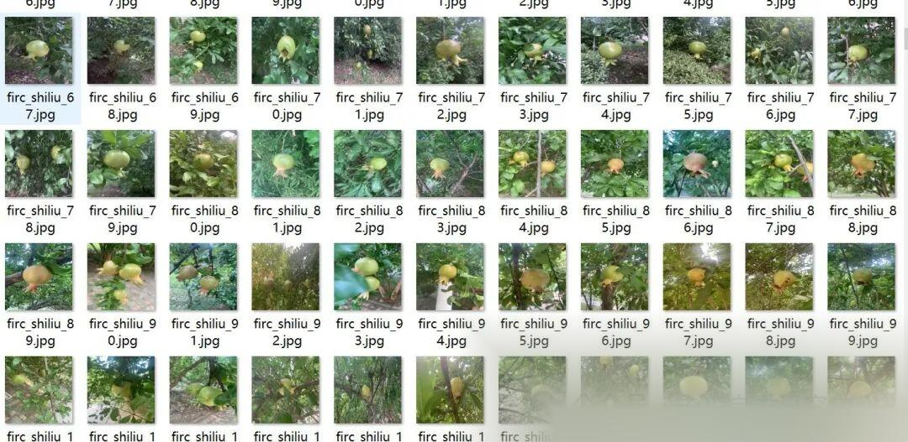
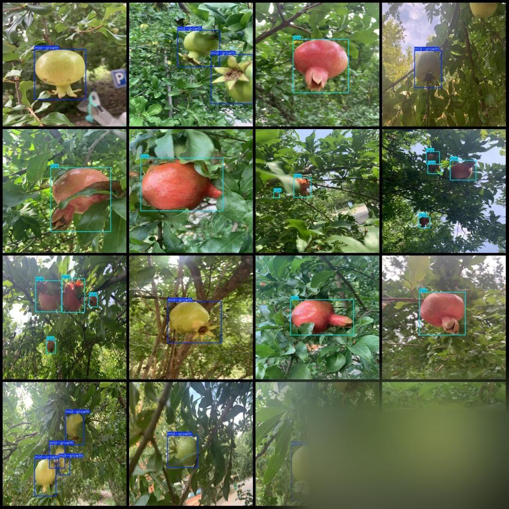

# Pomegranate maturity detection dataset VOC+YOLO format with 960 images in 5 categories

Dataset format: Pascal VOC format + YOLO format (txt file without split path, only containing jpg images and corresponding VOC format xml files and yolo format txt files)

Number of images (number of jpg files): 960

Number of annotations (number of xml files): 960

Number of annotations (number of txt files): 960

Label category count: 5

Label category names (note that the order of categories in the YOLO format does not correspond to this, but is based on the labels folder's classes.txt): ["bud", "early-fruit", "flower", "mid-growth", "ripe"]

Number of boxes labeled in each category:

Bud frame count = 14

early-fruit frame count = 60

Number of flower boxes = 37

Mid-growth frame count = 436

ripe frame count = 1349

Total frame count: 1896

Using labelImg:

Annotation rules: Draw a rectangle around the category.

Important Notice: No

Special : This dataset does not guarantee the accuracy or precision of the trained models or weight files. The dataset is provided with accurate and reasonable annotations only.

Image Preview:

Annotation example:

## Payment

Here is a pay link on Stripe ( https://buy.stripe.com/3cs8yP7sY87d0vu9AB ). Please contact me lonlonago@foxmail.com after funding $89, and I will send you a complete data files , thank you!

